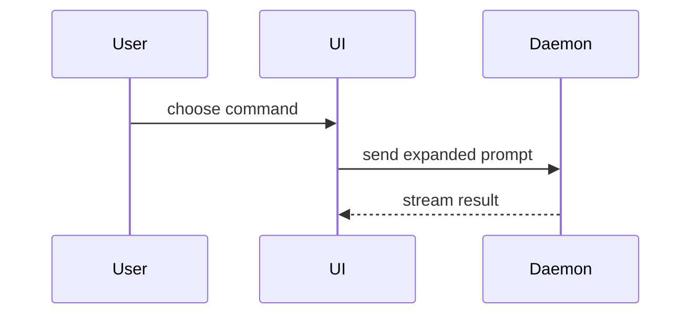

[Shared workflow](WORKFLOW.md)

Resolve and retain the absolute `.dev-skills/` workspace path according to the shared workflow before reading configuration or writing supporting artifacts. Pass that absolute path to any subagents; a subprocess changing directory must not change artifact destinations. Paths below beginning with `.dev-skills/` mean that resolved workspace, not a new directory relative to the subprocess. Use the workspace configuration and domain-document references, preserving existing authoritative project documents.


Read the real repository PR template first and follow it when present. Otherwise use this template for writing the PR body. Preserve the Summary / Evidence / Merge Danger content in the repository’s required shape where compatible. Read `git-conventions` for commit/title/branch conventions and issue references; this skill owns PR-body structure, not competing conventions.

Drafting alone does not authorize committing, pushing, PR creation, or remote updates. When the requested workflow needs Git or publication actions, load `git-conventions` and follow its upfront five-category ownership agreement and parent-owned approval route. Use the actual assigned branch, explicit PR base/head, and accurate issue references. Supporting artifacts stay outside staging and publication.

Use this default template:

```markdown
## Summary

<diagram, diff-sketch, or tree>

## Evidence

- **Before:** <screenshot/output/failing test run>
  **After:** <screenshot/output/passing test run>

## Merge Danger

**Door:** <one-way or two-way>

<optional: description>

**Blast Radius:** <one-word description>

<optional: potential ramifications of merge>
```

## Sections

Skip all preambles and keep prose brief. Use the user's domain language from the workspace `GLOSSARY.md` or authoritative glossary referenced by `domain.md`. Keep persisted PR prose normal even when chat uses Caveman.

### Summary

Pick the smallest view that makes the key point clear.

- Show logic or an algorithm as pseudocode:

```text
on(save)
  if content is unchanged
    return cached result
  write new content
  return fresh result
```

- Show runtime control flow as a call tree:

```text
submitForm
  createSession
    persistPrompt
    launchAgent
  navigateToSession
```

- Show UI structure as a component tree, including state and module boundaries that matter:

```text
<SessionPage> (apps/example/src/routes/session.tsx)
  useSessionEvents()
  <SessionToolbar>
    <RunSkillButton> (packages/ui)
```

- Show file responsibility or a broad refactor as a shallow file tree:

```text
src/
├── commands/       # parses user actions
├── sessions/       # owns session state
└── transport/      # sends API requests
```

- Show component interaction, control flow, or data flow with Mermaid:



- Use `diff` when the point is what changes and the surrounding shape already exists. Match the diff shape to the topic.

For a component change:

```diff
 <SessionPage>
   useSessionEvents()
   <SessionToolbar>
+    <RunSkillButton />
   <SessionTimeline>
+    <SkillResultCard />
```

For a file-layout change:

```diff
 src/
 ├── commands/
+│   └── show-me.ts       # expands the slash command
 ├── sessions/
-└── transport.ts
+└── transport/
+    ├── client.ts
+    └── stream.ts
```

For a call-tree or call-stack change:

```diff
 submitForm
   createSession
     persistPrompt
+    expandSkillMention
     launchAgent
-  navigateToSession
+  navigateToSession
+    subscribeToEvents
```

For a state or control-flow change:

```diff
 on(save)
-  write content
+  if content is unchanged
+    return cached result
+  write new content
+  invalidate cache
```

- Show the whole block when most of it is new, when omitted context would hide ownership or order, or when the user needs a copyable target shape:

```ts
function expandSkill(command: string): string {
  const skillName = command.slice(1);
  return `use the ${skillName} skill`;
}
```

#### Guidance

Place each visual next to the short text it supports. Keep only the calls, files, props, states, and boundaries needed to answer the user's current question or the options to resolve the current discussion point.

You may use one of these, you may use several, it is unlikely you will use all of them. Use your judgement and don't overwhelm the user.

### Evidence

Concrete observed evidence that the change works. Show a before and after when actually available; never invent screenshots, outputs, failing runs, or passing runs. If evidence was not collected, state what is missing and why. User-provided failure evidence counts; do not rerun merely to prove the user right. Keep sensitive payloads and secrets out of the PR.

Screenshots are S-tier - when the environment is set up for it and the change is visual.

Execution-based evidence is A-tier. Test results, console output. Name the exact exercised test/command and observed results. Pseudocode may explain the behavior, but is not an execution result. Do not claim a before failure or after pass without evidence.

### Merge Danger

Describe whether it's a one-way or two-way door. You can walk back through two-way doors, but not one-way doors. A PR that is cheap to roll back is lower risk. Changes that involve destructive actions or hard-to-reverse decisions are one-way doors.

The blast radius is the potential impact or scope of the changes introduced by this PR. Consider all possibilities. Examples are layout shift, breakages for consumers, mobile responsiveness, etc.


Use the actual diff and verification record, not expected outcomes. Include enough evidence in a remote PR body or approved accessible attachments; do not use local `.dev-skills/` links as the only evidence. If a durable local draft is requested, save it under the resolved `.dev-skills/reviews/<slug>.md`. Preserve the visual menu.
